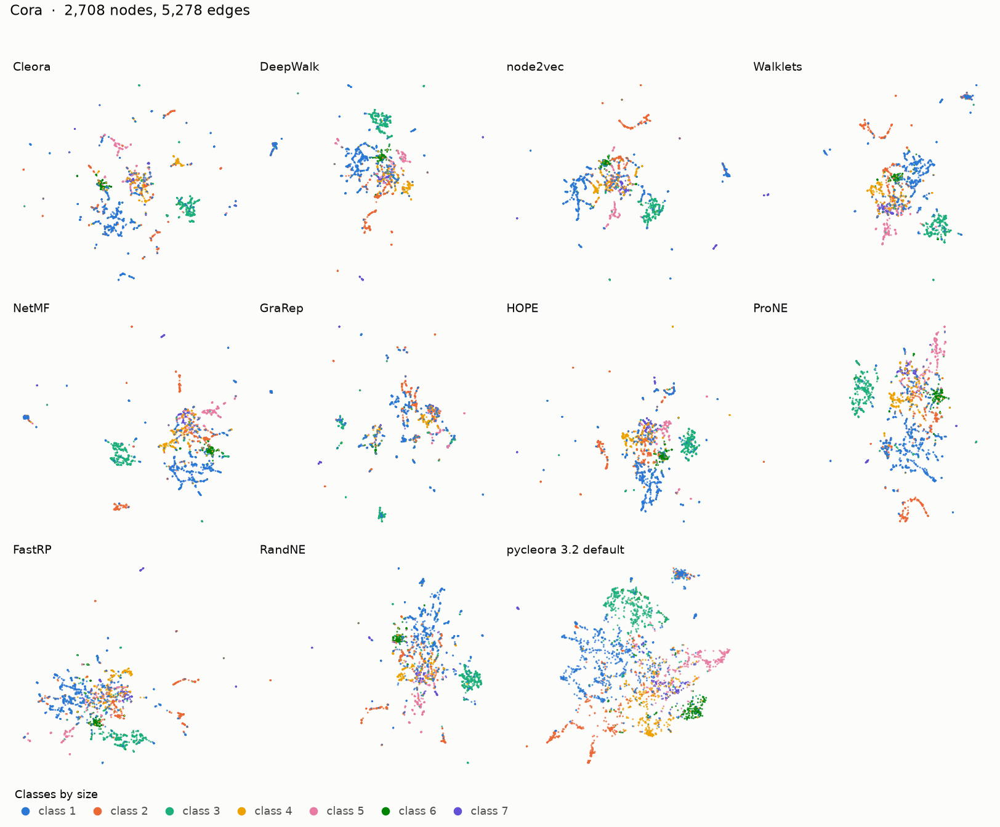
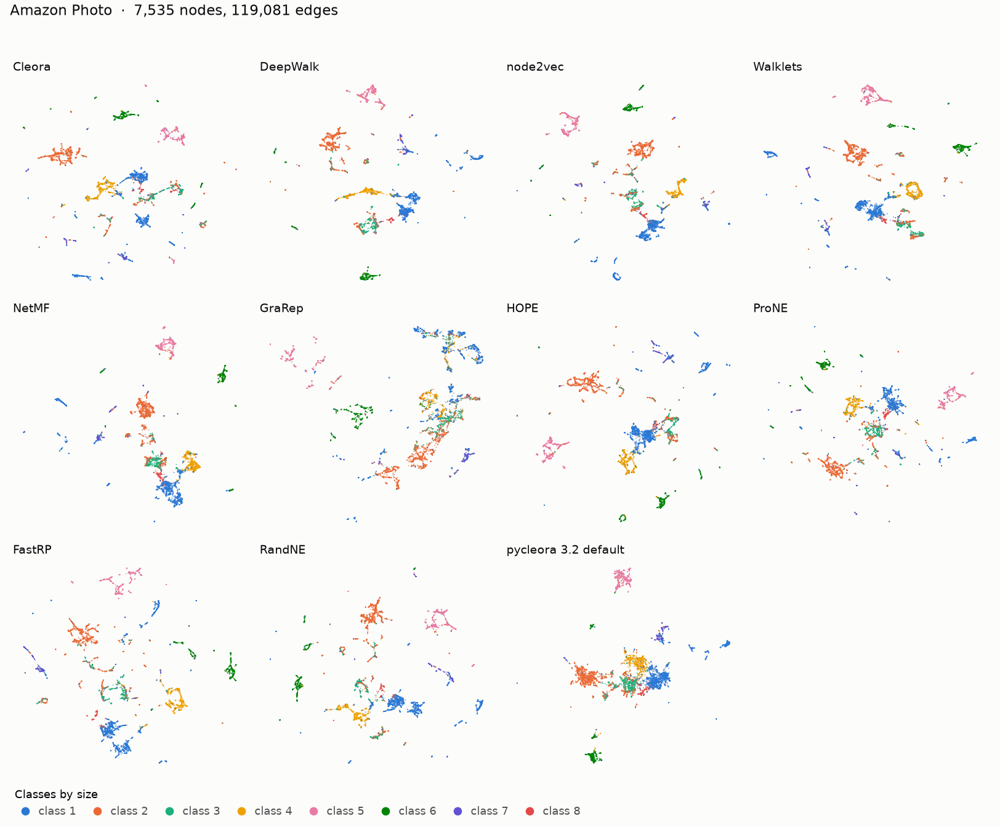
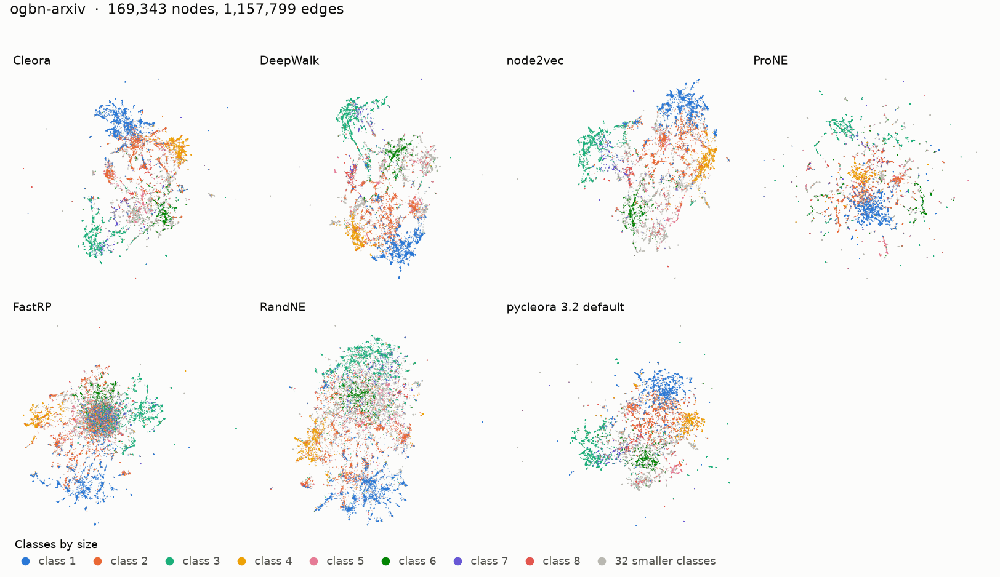

<p align="center">


</p>

<h1 align="center">The Graph Embedding Engine</h1>

<p align="center">
Cleora embeds the nodes of a graph or hypergraph by iterating one sparse matrix product:<br>
every vector becomes the normalised average of its neighbours' vectors.<br>
No sampling, no training, no GPU. Deterministic, and fast enough to tune in seconds.
</p>

<p align="center">
  <a href="https://cleora.ai">Website</a> &nbsp;·&nbsp;
  <a href="https://cleora.ai/docs">Documentation</a> &nbsp;·&nbsp;
  <a href="#benchmarks">Benchmarks</a> &nbsp;·&nbsp;
  <a href="benchmarks/README.md">Methodology</a> &nbsp;·&nbsp;
  <a href="benchmarks/RESULTS.md">All results</a>
</p>

<p align="center">
  <code>pip install pycleora</code>
</p>

---

<!-- benchmark:headline -->
| | Graphs | Cleora: best on | mean rank | Cleora, two columns: best on | mean rank | Best baseline (mean rank) |
|---|---:|---:|---:|---:|---:|---|
| Similarity search and link ranking (dot product / cosine, MRR) | 26 | **14** | 1.58 | 5 | 3.50 | RandNE (3.27) |
| Node classification (logistic regression, accuracy / micro-F1) | 17 | **10** | 2.00 | 7 | 2.24 | node2vec (3.35) |
<!-- /benchmark:headline -->

Every number on this page is generated from the benchmark's result files, and the
benchmark is one command: [`benchmarks/replicate.sh`](benchmarks/replicate.sh).

**New in 4.0** ([changelog](CHANGELOG.md))

- `embed(graph)` runs classic Cleora with a number of iterations chosen from the graph;
  per-iteration whitening, the default of 3.2, is opt-in.
- One embedding iteration is 3 to 4 times faster and graph construction 6 to 16 times
  ([Performance](#performance)); both are bit-for-bit deterministic for any number of
  threads.
- Initial vectors are independent (in 3.2 a 256-dimensional initialisation had an
  effective rank of 5), weights are honoured, bad input is reported, forked workers
  no longer hang.
- A benchmark that can be replicated with one command, against the reference
  implementations of nine other methods.

---

## Achievements

:one:st place at [SIGIR eCom Challenge 2020](https://sigir-ecom.github.io/ecom20DCPapers/SIGIR_eCom20_DC_paper_1.pdf)

:two:nd place and Best Paper Award at [WSDM Booking.com Challenge 2021](http://ceur-ws.org/Vol-2855/challenge_short_3.pdf)

:two:nd place at [Twitter Recsys Challenge 2021](https://recsys-twitter.com/competition_leaderboard/latest)

:three:rd place at [KDD Cup 2021](https://ogb.stanford.edu/paper/kddcup2021/mag240m_SyneriseAI.pdf)

---

## Installation

```bash
pip install pycleora
```

Python 3.10 to 3.15 on Linux (x86-64, arm64), macOS (Apple silicon, Intel) and Windows:
one `abi3` wheel per platform. NumPy is the only required dependency.

```bash
pip install "pycleora[scipy]"   # the extra algorithms, attention / directed embeddings, graph statistics
pip install "pycleora[viz]"     # matplotlib for visualization
pip install "pycleora[full]"    # scipy + matplotlib + networkx + tqdm
```

## Quick start

```python
from pycleora import SparseMatrix, embed, find_most_similar

# one line per shopping basket: the products that were bought together
baskets = [
    "laptop mouse keyboard",
    "laptop mouse monitor",
    "keyboard mouse",
    "espresso_machine coffee_beans",
    "coffee_beans mug",
    "espresso_machine coffee_beans mug",
]
graph = SparseMatrix.from_iterator(iter(baskets), "complex::reflexive::product")

# seven products: two iterations are plenty
embeddings = embed(graph, feature_dim=64, num_iterations=2)

for hit in find_most_similar(graph, embeddings, "laptop", top_k=3):
    print(f"{hit['entity_id']}: {hit['similarity']:.3f}")
# mouse: 0.990, monitor: 0.987, keyboard: 0.968
```

On real data `embed(graph)` is enough: 256 dimensions, and a number of iterations taken
from the graph itself. For a plain graph, pass the edges as arrays:

```python
import numpy as np

source = np.array([0, 0, 1, 2, 3])
target = np.array([1, 2, 2, 3, 4])
network = SparseMatrix.from_edges(source, target, columns="complex::reflexive::node")
vectors = embed(network, feature_dim=1024)           # row i belongs to network.entity_ids[i]
```

### The three choices that matter

**1. How the graph is given.** A column that is `complex::reflexive` relates the
entities of a line to each other *and to themselves*; two plain columns relate the
entity in the first to the entity in the second.

| | Columns | Use it for |
|---|---|---|
| one column | `complex::reflexive::node` | similarity between entities of one kind: products in baskets, pages in sessions, the nodes of a graph. In the benchmark it is the better setup for nearest-neighbour search and link ranking ([table](benchmarks/RESULTS.md#cleora-the-four-ways-of-feeding-and-normalising-a-graph)). |
| two columns | `src dst`, `user product` | relations between two kinds of entities; half the iterations for the same reach. In a bipartite graph the two kinds are built from disjoint sets of initial vectors, so a user's vector can be compared with other users' but not with a product's. |

**2. The normalisation.** `propagation="left"` (default) averages over neighbours and
is the choice for classification features; `propagation="symmetric"` additionally
down-weights hubs and is the choice for similarity search and link ranking
([evidence](benchmarks/README.md#one-configuration-per-method)).

**3. The number of iterations.** Few iterations keep vectors local (who are my
neighbours?), many make them global (which community am I in?). The default,
`num_iterations="auto"`, takes a compromise from the density of the graph. If the use
of the vectors is known, ask for it:

```python
k = graph.suggest_iterations("symmetric", purpose="similarity")       # or "classification", "general"
embeddings = embed(graph, 1024, k, propagation="symmetric")
```

and if there is a validation set, tune it - one run hands out the vectors of every
iteration:

```python
snapshots = {}
embed(graph, 1024, 32, callback=lambda i, vectors: snapshots.__setitem__(i + 1, vectors))
# evaluate snapshots[2], snapshots[4], ... on validation data and keep the best
```

[How the rule was derived and how close it gets](benchmarks/README.md#number-of-iterations).

### More

**Weights.** A weight per edge or hyperedge is part of the transition matrix; an
integer weight `k` equals repeating the line `k` times.

```python
weighted = SparseMatrix.from_edges(source, target, weights=[1.0, 0.5, 2.0, 1.0, 3.0])
weighted = SparseMatrix.from_iterator(iter(baskets), "complex::reflexive::product", weights=[1, 3, 1, 1, 2, 1])
```

**New data without retraining.** `embed_inductive` adds edges and entities to an
embedded graph. Vectors that already exist stay exactly as they are - models trained on
them remain valid - and every new entity is placed at the weighted average of its
neighbours:

```python
from pycleora import embed_inductive

graph, embeddings = embed_inductive(
    graph, embeddings, existing_edges=baskets, new_edges=["mug tea_bags"],
    columns="complex::reflexive::product",
)
```

**Your own features.** `embed(graph, initial_embeddings=features)` propagates text,
image or numeric vectors along the graph instead of random ones.

**The loop itself.** `embed` is a thin wrapper; the pieces are public:

```python
vectors = graph.initialize_deterministically(256, seed=0)
graph.left_markov_propagate_normalized_inplace(vectors, 8)   # 8 iterations, in place, two matrices of memory
```

**Whitening.** `embed(graph, num_iterations=40, whiten=True)` PCA-whitens the columns
after every iteration - the default of pycleora 3.2. It needs many more entities than
dimensions and 25 to 400 times the time. On small graphs it is clearly worse than the
default, on graphs with hundreds of nodes per dimension it can classify better
([Reading the results honestly](#reading-the-results-honestly)).

### Command line

```bash
pycleora embed --input graph.tsv --output embeddings.npz --dim 1024
pycleora embed --input graph.tsv --output embeddings.npz --iterations 12 --propagation symmetric
pycleora info --input graph.tsv
pycleora similar --input graph.tsv --entity alice --top-k 10
```

---

## Benchmarks

Nine embedding methods, each run from its authors' code or a standard library with the
authors' settings, against Cleora on 26 public graphs, from a few thousand to 62 million
edges. All methods see the graph only - no node features, no labels - and produce
**1024-dimensional** vectors. The vectors are frozen and judged by probes: logistic
regression, linear SVM, an MLP and k-NN for node classification; dot product, cosine,
a bilinear form, an MLP and linear models for link ranking.
[Methodology](benchmarks/README.md) · [all tables](benchmarks/RESULTS.md)

**One configuration per method, the same for every graph.** Nothing is chosen per
dataset - not for the baselines, and not for Cleora, which runs with the settings
recommended above for the task: left normalisation and `purpose="classification"` for
node classification, symmetric normalisation and `purpose="similarity"` for link
ranking. Both ways of feeding a graph are shown: **Cleora** (one reflexive column) and
**Cleora, two columns**.

### Mean rank across graphs

Mean rank of every method over the graphs of a task (1 = best), per probe; in
parentheses the number of graphs it is the best method on. The two Cleora columns
are not ranked against each other.

Node classification (accuracy, or micro-F1 on multi-label graphs):

<!-- benchmark:ranks_nc -->
| Probe | Graphs | Cleora | Cleora, two columns | DeepWalk | node2vec | Walklets | NetMF | GraRep | HOPE | ProNE | FastRP | RandNE |
|---|---:|---:|---:|---:|---:|---:|---:|---:|---:|---:|---:|---:|
| logistic regression | 17 | **2.00** (10) | 2.24 (7) | 4.18 (0) | 3.35 (1) | 5.53 (0) | 4.88 (2) | 7.00 (0) | 7.53 (0) | 6.47 (1) | 6.18 (1) | 5.24 (2) |
| linear SVM | 17 | **2.12** (9) | 2.29 (7) | 4.41 (0) | 3.47 (2) | 5.24 (0) | 5.06 (1) | 7.18 (0) | 7.47 (0) | 6.12 (1) | 5.94 (2) | 5.35 (2) |
| MLP (AdamC) | 17 | **1.94** (11) | 2.76 (6) | 3.35 (0) | 2.94 (1) | 5.00 (0) | 6.71 (0) | 6.82 (0) | 7.29 (0) | 6.82 (1) | 6.06 (1) | 5.41 (3) |
| k-NN (cosine) | 17 | 4.00 (4) | 4.53 (4) | 4.41 (0) | **3.59** (2) | 5.53 (0) | 4.41 (3) | 8.35 (0) | 7.71 (0) | 3.82 (6) | 5.06 (2) | 5.47 (0) |
<!-- /benchmark:ranks_nc -->

Link ranking (MRR of the true neighbour against 500 non-neighbours):

<!-- benchmark:ranks_lp -->
| Probe | Graphs | Cleora | Cleora, two columns | DeepWalk | node2vec | Walklets | NetMF | GraRep | HOPE | ProNE | FastRP | RandNE |
|---|---:|---:|---:|---:|---:|---:|---:|---:|---:|---:|---:|---:|
| dot product or cosine | 26 | **1.58** (14) | 3.50 (5) | 6.19 (0) | 6.31 (1) | 6.12 (0) | 5.88 (0) | 7.31 (0) | 4.81 (2) | 4.54 (4) | 4.38 (0) | 3.27 (5) |
| dot product | 26 | **1.58** (14) | 3.46 (4) | 6.12 (0) | 6.54 (1) | 5.96 (0) | 6.35 (0) | 7.31 (0) | 4.65 (2) | 4.23 (4) | 4.54 (0) | 3.12 (5) |
| cosine | 26 | **1.38** (17) | 2.69 (11) | 6.50 (0) | 6.38 (0) | 6.62 (0) | 5.31 (0) | 7.54 (0) | 6.42 (0) | 3.62 (4) | 4.04 (0) | 2.58 (5) |
| bilinear x'My (AdamC) | 26 | 5.00 (1) | 4.73 (2) | 3.92 (0) | **3.54** (7) | 4.15 (8) | 5.62 (2) | 7.65 (0) | 7.12 (0) | 4.08 (4) | 4.54 (0) | 4.77 (4) |
| concat -> MLP -> sigmoid (AdamC) | 26 | 3.38 (3) | 4.08 (2) | 5.54 (1) | 5.27 (1) | 5.27 (0) | 5.58 (0) | 7.08 (2) | 5.08 (3) | **2.73** (13) | 5.69 (0) | 4.77 (3) |
| logistic regression on x*y | 26 | **1.73** (11) | 3.12 (5) | 6.04 (0) | 6.12 (0) | 6.15 (0) | 6.23 (0) | 7.46 (0) | 5.62 (0) | 2.50 (11) | 4.73 (0) | 3.81 (4) |
| linear SVM on x*y | 26 | **1.96** (10) | 3.27 (4) | 6.04 (0) | 6.31 (0) | 5.92 (0) | 6.35 (0) | 7.58 (0) | 5.62 (0) | 2.54 (11) | 4.69 (0) | 3.38 (5) |
<!-- /benchmark:ranks_lp -->

### Link ranking and similarity search

MRR with the training-free scores - dot product or cosine, whichever validates better:
what a nearest-neighbour index over the vectors would return.

<!-- benchmark:lp_mrr_similarity -->
| Dataset | Cleora | Cleora, two columns | DeepWalk | node2vec | Walklets | NetMF | GraRep | HOPE | ProNE | FastRP | RandNE |
|---|---:|---:|---:|---:|---:|---:|---:|---:|---:|---:|---:|
| CiteSeer | **0.440 ± 0.024** | 0.390 ± 0.022 | 0.400 ± 0.024 | 0.400 ± 0.018 | 0.389 ± 0.030 | <u>0.421 ± 0.025</u> | 0.291 ± 0.020 | 0.396 ± 0.029 | 0.386 ± 0.025 | 0.402 ± 0.029 | 0.393 ± 0.026 |
| Cora | **0.387 ± 0.009** | <u>0.365 ± 0.010</u> | 0.345 ± 0.007 | 0.348 ± 0.010 | 0.338 ± 0.002 | 0.364 ± 0.002 | 0.203 ± 0.006 | 0.351 ± 0.006 | 0.336 ± 0.005 | 0.363 ± 0.013 | 0.351 ± 0.007 |
| PPI | **0.204 ± 0.002** | 0.163 ± 0.002 | 0.070 ± 0.001 | 0.070 ± 0.001 | 0.135 ± 0.002 | 0.122 ± 0.002 | 0.091 ± 0.003 | 0.169 ± 0.002 | 0.125 ± 0.001 | 0.156 ± 0.004 | <u>0.183 ± 0.001</u> |
| PubMed | **0.428 ± 0.007** | 0.304 ± 0.002 | 0.312 ± 0.006 | 0.300 ± 0.007 | <u>0.420 ± 0.005</u> | 0.369 ± 0.007 | 0.207 ± 0.007 | 0.367 ± 0.003 | 0.328 ± 0.007 | 0.316 ± 0.006 | 0.330 ± 0.004 |
| DBLP | **0.524 ± 0.006** | 0.487 ± 0.006 | 0.381 ± 0.002 | 0.382 ± 0.002 | 0.433 ± 0.015 | 0.466 ± 0.005 | 0.259 ± 0.004 | 0.462 ± 0.006 | 0.433 ± 0.006 | 0.478 ± 0.005 | <u>0.492 ± 0.004</u> |
| Cora-Full | **0.643 ± 0.001** | <u>0.615 ± 0.002</u> | 0.532 ± 0.003 | 0.533 ± 0.004 | 0.587 ± 0.002 | 0.601 ± 0.002 | 0.340 ± 0.006 | 0.560 ± 0.004 | 0.579 ± 0.003 | 0.612 ± 0.002 | 0.614 ± 0.000 |
| Facebook (ego) | <u>0.595 ± 0.002</u> | 0.545 ± 0.004 | 0.447 ± 0.005 | 0.446 ± 0.001 | 0.454 ± 0.024 | 0.518 ± 0.003 | 0.256 ± 0.010 | 0.577 ± 0.003 | **0.601 ± 0.002** | 0.509 ± 0.004 | 0.550 ± 0.003 |
| Coauthor CS | <u>0.634 ± 0.001</u> | 0.613 ± 0.002 | 0.534 ± 0.002 | 0.538 ± 0.003 | 0.564 ± 0.018 | 0.611 ± 0.002 | 0.298 ± 0.002 | 0.556 ± 0.003 | 0.617 ± 0.002 | 0.630 ± 0.002 | **0.648 ± 0.001** |
| Amazon Photo | **0.508 ± 0.004** | 0.411 ± 0.004 | 0.326 ± 0.002 | 0.326 ± 0.003 | 0.378 ± 0.003 | 0.401 ± 0.003 | 0.187 ± 0.002 | <u>0.456 ± 0.002</u> | 0.427 ± 0.005 | 0.412 ± 0.003 | 0.427 ± 0.003 |
| Wikipedia POS | **0.251 ± 0.003** | 0.210 ± 0.004 | 0.046 ± 0.001 | 0.048 ± 0.002 | 0.070 ± 0.002 | 0.046 ± 0.001 | 0.069 ± 0.001 | <u>0.242 ± 0.005</u> | 0.058 ± 0.001 | 0.112 ± 0.003 | 0.097 ± 0.001 |
| Amazon Computers | **0.483 ± 0.001** | 0.410 ± 0.002 | 0.283 ± 0.002 | 0.285 ± 0.001 | 0.329 ± 0.003 | 0.399 ± 0.003 | 0.126 ± 0.001 | <u>0.421 ± 0.001</u> | 0.405 ± 0.003 | 0.394 ± 0.003 | 0.409 ± 0.003 |
| Coauthor Physics | 0.737 ± 0.002 | 0.719 ± 0.002 | 0.676 ± 0.003 | 0.674 ± 0.003 | 0.669 ± 0.002 | 0.651 ± 0.001 | 0.343 ± 0.003 | 0.621 ± 0.001 | <u>0.739 ± 0.001</u> | 0.725 ± 0.001 | **0.752 ± 0.002** |
| BlogCatalog | **0.218 ± 0.001** | 0.114 ± 0.001 | 0.070 ± 0.001 | 0.070 ± 0.001 | 0.092 ± 0.001 | 0.055 ± 0.000 | 0.165 ± 0.002 | <u>0.209 ± 0.001</u> | 0.070 ± 0.000 | 0.098 ± 0.000 | 0.096 ± 0.000 |
| Flickr | **0.283 ± 0.001** | 0.122 ± 0.001 | <u>0.244 ± 0.001</u> | 0.243 ± 0.000 | n/a (size) | n/a (size) | n/a (size) | n/a (size) | 0.195 ± 0.001 | 0.154 ± 0.001 | 0.189 ± 0.000 |
| MovieLens-1M | <u>0.148 ± 0.001</u> | 0.008 ± 0.001 | 0.060 ± 0.000 | 0.059 ± 0.000 | 0.044 ± 0.001 | 0.081 ± 0.001 | 0.108 ± 0.001 | **0.149 ± 0.012** | 0.144 ± 0.000 | 0.023 ± 0.001 | 0.102 ± 0.009 |
| ogbl-ddi | <u>0.027 ± 0.002</u> | 0.003 ± 0.000 | 0.005 ± 0.000 | 0.005 ± 0.000 | 0.010 ± 0.001 | 0.001 ± 0.000 | 0.012 ± 0.001 | **0.083 ± 0.002** | 0.002 ± 0.000 | 0.001 ± 0.000 | 0.002 ± 0.000 |
| ogbn-arxiv | **0.671 ± 0.001** | <u>0.617 ± 0.001</u> | 0.547 ± 0.002 | 0.539 ± 0.001 | n/a (size) | n/a (size) | n/a (size) | n/a (size) | 0.580 ± 0.002 | 0.593 ± 0.001 | 0.606 ± 0.002 |
| ogbl-collab | 0.057 ± 0.002 | 0.054 ± 0.001 | <u>0.094 ± 0.005</u> | **0.099 ± 0.008** | n/a (size) | n/a (size) | n/a (size) | n/a (size) | 0.039 ± 0.001 | 0.059 ± 0.001 | 0.053 ± 0.001 |
| roadNet-CA | <u>0.752</u> | 0.614 | time limit | time limit | n/a (size) | n/a (size) | n/a (size) | n/a (size) | **0.778** | 0.374 | 0.413 |
| Yelp | <u>0.495</u> | 0.472 | 0.302 | 0.285 | n/a (size) | n/a (size) | n/a (size) | n/a (size) | 0.445 | 0.361 | **0.513** |
| Reddit | 0.605 | **0.645** | 0.323 | 0.315 | n/a (size) | n/a (size) | n/a (size) | n/a (size) | <u>0.626</u> | 0.467 | 0.508 |
| MovieLens-20M | <u>0.209</u> | 0.014 | 0.105 | 0.104 | n/a (size) | n/a (size) | n/a (size) | n/a (size) | **0.227** | 0.020 | 0.202 |
| ogbl-ppa | **0.069** | 0.019 | 0.007 | 0.006 | n/a (size) | n/a (size) | n/a (size) | n/a (size) | 0.009 | <u>0.034</u> | 0.014 |
| ogbl-citation2 | 0.802 | **0.839** | time limit | time limit | n/a (size) | n/a (size) | n/a (size) | n/a (size) | out of memory | 0.793 | <u>0.829</u> |
| LiveJournal | 0.756 | <u>0.766</u> | time limit | time limit | n/a (size) | n/a (size) | n/a (size) | n/a (size) | out of memory | 0.685 | **0.776** |
| ogbn-products | **0.909** | 0.904 | time limit | time limit | n/a (size) | n/a (size) | n/a (size) | n/a (size) | out of memory | 0.892 | <u>0.906</u> |
| *mean rank* | **1.58** | 3.50 | 6.19 | 6.31 | 6.12 | 5.88 | 7.31 | 4.81 | 4.54 | 4.38 | 3.27 |
| *best on* | 14 / 26 | 5 / 26 | 0 / 22 | 1 / 22 | 0 / 15 | 0 / 15 | 0 / 15 | 2 / 15 | 4 / 23 | 0 / 26 | 5 / 26 |
<!-- /benchmark:lp_mrr_similarity -->

### Node classification

Accuracy of logistic regression on 10% of the labels (or the official split):

<!-- benchmark:nc_accuracy_logistic -->
| Dataset | Cleora | Cleora, two columns | DeepWalk | node2vec | Walklets | NetMF | GraRep | HOPE | ProNE | FastRP | RandNE |
|---|---:|---:|---:|---:|---:|---:|---:|---:|---:|---:|---:|
| CiteSeer | <u>0.566 ± 0.011</u> | 0.551 ± 0.011 | 0.543 ± 0.008 | 0.555 ± 0.007 | 0.538 ± 0.011 | **0.572 ± 0.007** | 0.546 ± 0.016 | 0.450 ± 0.015 | 0.437 ± 0.009 | 0.486 ± 0.007 | 0.474 ± 0.009 |
| Cora | **0.785 ± 0.010** | <u>0.783 ± 0.008</u> | 0.765 ± 0.007 | 0.761 ± 0.009 | 0.755 ± 0.009 | 0.766 ± 0.003 | 0.715 ± 0.010 | 0.601 ± 0.009 | 0.589 ± 0.011 | 0.701 ± 0.008 | 0.688 ± 0.014 |
| PubMed | **0.811 ± 0.005** | 0.805 ± 0.003 | 0.802 ± 0.002 | 0.803 ± 0.003 | 0.800 ± 0.005 | <u>0.806 ± 0.001</u> | 0.776 ± 0.006 | 0.775 ± 0.005 | 0.756 ± 0.003 | 0.715 ± 0.003 | 0.707 ± 0.004 |
| DBLP | **0.808 ± 0.003** | 0.802 ± 0.002 | 0.802 ± 0.003 | <u>0.803 ± 0.003</u> | 0.798 ± 0.004 | 0.797 ± 0.003 | 0.777 ± 0.006 | 0.750 ± 0.001 | 0.732 ± 0.004 | 0.685 ± 0.004 | 0.679 ± 0.003 |
| Cora-Full | **0.586 ± 0.001** | <u>0.579 ± 0.001</u> | 0.569 ± 0.002 | 0.569 ± 0.004 | 0.573 ± 0.004 | 0.572 ± 0.004 | 0.486 ± 0.004 | 0.530 ± 0.000 | 0.534 ± 0.001 | 0.518 ± 0.005 | 0.520 ± 0.002 |
| Coauthor CS | **0.876 ± 0.002** | **0.876 ± 0.002** | 0.868 ± 0.002 | <u>0.869 ± 0.002</u> | 0.866 ± 0.001 | 0.864 ± 0.002 | 0.805 ± 0.003 | 0.821 ± 0.004 | 0.793 ± 0.003 | 0.789 ± 0.002 | 0.783 ± 0.005 |
| Amazon Photo | **0.917 ± 0.004** | **0.917 ± 0.002** | 0.907 ± 0.002 | 0.910 ± 0.002 | 0.907 ± 0.002 | 0.912 ± 0.006 | 0.857 ± 0.004 | 0.899 ± 0.002 | 0.878 ± 0.005 | 0.909 ± 0.005 | <u>0.913 ± 0.005</u> |
| Amazon Computers | **0.892 ± 0.002** | 0.889 ± 0.003 | 0.876 ± 0.002 | 0.877 ± 0.003 | 0.872 ± 0.002 | 0.885 ± 0.004 | 0.801 ± 0.003 | 0.868 ± 0.001 | 0.860 ± 0.004 | <u>0.890 ± 0.002</u> | 0.888 ± 0.002 |
| Coauthor Physics | 0.928 ± 0.001 | 0.927 ± 0.002 | <u>0.931 ± 0.001</u> | <u>0.931 ± 0.002</u> | 0.926 ± 0.001 | **0.932 ± 0.001** | 0.905 ± 0.001 | 0.896 ± 0.002 | 0.906 ± 0.002 | 0.868 ± 0.000 | 0.859 ± 0.004 |
| Flickr | <u>0.539 ± 0.002</u> | **0.544 ± 0.001** | 0.533 ± 0.001 | 0.533 ± 0.001 | n/a (size) | n/a (size) | n/a (size) | n/a (size) | 0.535 ± 0.001 | 0.493 ± 0.000 | 0.515 ± 0.001 |
| ogbn-arxiv | <u>0.681 ± 0.001</u> | 0.670 ± 0.002 | **0.685 ± 0.001** | **0.685 ± 0.001** | n/a (size) | n/a (size) | n/a (size) | n/a (size) | 0.663 ± 0.002 | 0.569 ± 0.000 | 0.592 ± 0.003 |
| Reddit | **0.941** | 0.937 | 0.937 | <u>0.940</u> | n/a (size) | n/a (size) | n/a (size) | n/a (size) | 0.937 | 0.936 | <u>0.940</u> |
| ogbn-products | **0.645** | <u>0.634</u> | time limit | time limit | n/a (size) | n/a (size) | n/a (size) | n/a (size) | out of memory | 0.556 | 0.562 |
| *mean rank* | **1.46** | 2.08 | 4.00 | 3.15 | 5.31 | 3.92 | 7.00 | 7.23 | 6.85 | 6.69 | 6.38 |
| *best on* | 10 / 13 | 6 / 13 | 0 / 12 | 1 / 12 | 0 / 9 | 2 / 9 | 0 / 9 | 0 / 9 | 0 / 12 | 0 / 13 | 0 / 13 |
<!-- /benchmark:nc_accuracy_logistic -->

Multi-label graphs, micro-F1:

<!-- benchmark:nc_micro_f1_logistic -->
| Dataset | Cleora | Cleora, two columns | DeepWalk | node2vec | Walklets | NetMF | GraRep | HOPE | ProNE | FastRP | RandNE |
|---|---:|---:|---:|---:|---:|---:|---:|---:|---:|---:|---:|
| PPI | <u>0.127 ± 0.011</u> | 0.125 ± 0.014 | 0.106 ± 0.004 | 0.106 ± 0.006 | 0.120 ± 0.008 | 0.091 ± 0.013 | 0.076 ± 0.014 | 0.104 ± 0.010 | 0.096 ± 0.013 | 0.123 ± 0.008 | **0.129 ± 0.008** |
| Wikipedia POS | 0.383 ± 0.010 | **0.410 ± 0.011** | 0.369 ± 0.008 | 0.371 ± 0.010 | 0.368 ± 0.008 | 0.337 ± 0.036 | 0.361 ± 0.006 | 0.290 ± 0.071 | 0.365 ± 0.013 | 0.340 ± 0.006 | <u>0.409 ± 0.012</u> |
| BlogCatalog | 0.259 ± 0.006 | 0.284 ± 0.005 | 0.277 ± 0.007 | 0.284 ± 0.005 | 0.255 ± 0.007 | 0.276 ± 0.008 | 0.283 ± 0.005 | 0.213 ± 0.003 | 0.276 ± 0.005 | **0.332 ± 0.009** | <u>0.301 ± 0.009</u> |
| Yelp | 0.217 | 0.188 | 0.202 | 0.201 | n/a (size) | n/a (size) | n/a (size) | n/a (size) | **0.284** | 0.185 | <u>0.244</u> |
| *mean rank* | 3.75 | 2.75 | 4.75 | 4.00 | 6.25 | 8.00 | 7.00 | 8.50 | 5.25 | 4.50 | **1.50** |
| *best on* | 0 / 4 | 1 / 4 | 0 / 4 | 0 / 4 | 0 / 3 | 0 / 3 | 0 / 3 | 0 / 3 | 1 / 4 | 1 / 4 | 2 / 4 |
<!-- /benchmark:nc_micro_f1_logistic -->

### With a validation set

The tables above use no per-graph tuning. When labels or held-out edges are available,
choosing the number of iterations and the normalisation on them costs seconds per
candidate and adds about a point:

<!-- benchmark:tuned_nc -->
| Dataset | Cleora | Cleora, tuned | gain | Best baseline |
|---|---:|---:|---:|---|
| CiteSeer | 0.566 | **0.579** | +1.3 | NetMF 0.572 |
| Cora | 0.785 | **0.791** | +0.6 | NetMF 0.766 |
| PubMed | 0.811 | **0.814** | +0.3 | NetMF 0.806 |
| DBLP | 0.808 | **0.817** | +0.9 | node2vec 0.803 |
| Cora-Full | 0.586 | **0.587** | +0.1 | Walklets 0.573 |
| Coauthor CS | 0.876 | **0.882** | +0.6 | node2vec 0.869 |
| Amazon Photo | 0.917 | **0.924** | +0.7 | RandNE 0.913 |
| Amazon Computers | 0.892 | **0.901** | +0.9 | FastRP 0.890 |
| Coauthor Physics | 0.928 | **0.938** | +1.0 | NetMF 0.932 |
| Flickr | 0.539 | **0.544** | +0.6 | ProNE 0.535 |
| ogbn-arxiv | 0.681 | **0.702** | +2.1 | node2vec 0.685 |
| Reddit | 0.941 | **0.945** | +0.4 | RandNE 0.940 |
| ogbn-products | **0.645** | 0.637 | -0.8 | RandNE 0.562 |
| PPI | 0.127 | **0.131** | +0.3 | RandNE 0.129 |
| Wikipedia POS | 0.383 | **0.428** | +4.5 | RandNE 0.409 |
| BlogCatalog | 0.259 | 0.299 | +4.0 | FastRP 0.332 |
| Yelp | 0.217 | 0.255 | +3.8 | ProNE 0.284 |
| *mean gain (points)* | | | +1.3 | |
<!-- /benchmark:tuned_nc -->

<!-- benchmark:tuned_lp -->
| Dataset | Cleora | Cleora, tuned | gain | Best baseline |
|---|---:|---:|---:|---|
| CiteSeer | 0.440 | **0.445** | +0.6 | NetMF 0.421 |
| Cora | 0.387 | **0.388** | +0.2 | NetMF 0.364 |
| PPI | 0.204 | **0.207** | +0.3 | RandNE 0.183 |
| PubMed | **0.428** | 0.427 | -0.0 | Walklets 0.420 |
| DBLP | 0.524 | **0.529** | +0.5 | RandNE 0.492 |
| Cora-Full | 0.643 | **0.649** | +0.6 | RandNE 0.614 |
| Facebook (ego) | 0.595 | **0.608** | +1.3 | ProNE 0.601 |
| Coauthor CS | 0.634 | **0.657** | +2.3 | RandNE 0.648 |
| Amazon Photo | 0.508 | **0.520** | +1.2 | HOPE 0.456 |
| Wikipedia POS | **0.251** | **0.251** | +0.0 | HOPE 0.242 |
| Amazon Computers | 0.483 | **0.493** | +1.0 | HOPE 0.421 |
| Coauthor Physics | 0.737 | **0.765** | +2.9 | RandNE 0.752 |
| BlogCatalog | **0.218** | **0.218** | +0.0 | HOPE 0.209 |
| Flickr | 0.283 | **0.297** | +1.4 | DeepWalk 0.244 |
| MovieLens-1M | 0.148 | 0.148 | +0.0 | HOPE 0.149 |
| ogbl-ddi | 0.027 | 0.027 | +0.0 | HOPE 0.083 |
| ogbn-arxiv | **0.671** | **0.671** | +0.0 | RandNE 0.606 |
| ogbl-collab | 0.057 | 0.055 | -0.2 | node2vec 0.099 |
| roadNet-CA | 0.752 | 0.752 | +0.0 | ProNE 0.778 |
| Yelp | 0.495 | 0.504 | +0.8 | RandNE 0.513 |
| Reddit | 0.605 | **0.745** | +14.0 | ProNE 0.626 |
| MovieLens-20M | 0.209 | 0.209 | +0.0 | ProNE 0.227 |
| ogbl-ppa | **0.069** | **0.069** | +0.0 | FastRP 0.034 |
| ogbl-citation2 | 0.802 | **0.838** | +3.6 | RandNE 0.829 |
| LiveJournal | 0.756 | **0.799** | +4.3 | RandNE 0.776 |
| ogbn-products | **0.909** | **0.909** | +0.0 | RandNE 0.906 |
| *mean gain (points)* | | | +1.3 | |
<!-- /benchmark:tuned_lp -->

### Time and memory

Time to embed the whole graph at 1024 dimensions, one method at a time on an idle
24-thread machine (median of three runs; single runs for the longest ones):

<!-- benchmark:time -->
| Dataset | Cleora | pycleora 3.2 default | DeepWalk | node2vec | Walklets | NetMF | GraRep | HOPE | ProNE | FastRP | RandNE |
|---|---:|---:|---:|---:|---:|---:|---:|---:|---:|---:|---:|
| Cora | **75 ms** | 27.9 s | 5.7 s | 7.1 s | 7.0 s | 2.1 min | 8.2 s | 2.2 s | 2.7 s | 718 ms | 705 ms |
| PubMed | **194 ms** | 29.8 s | 44.2 s | 46.1 s | 57.0 s | 8.2 min | 2.9 min | 14.4 s | 16.3 s | 1.8 s | 1.2 s |
| Amazon Computers | **146 ms** | 25.7 s | 25.9 s | 30.1 s | 60.9 s | 5.3 min | 6.7 min | 2.4 min | 18.3 s | 2.5 s | 1.7 s |
| Flickr | **928 ms** | 62.9 s | 10.0 min | 10.1 min | n/a (size) | n/a (size) | n/a (size) | n/a (size) | 82.6 s | 7.7 s | 5.0 s |
| ogbn-arxiv | **1.8 s** | 1.8 min | 17.4 min | 18.1 min | n/a (size) | n/a (size) | n/a (size) | n/a (size) | 2.9 min | 13.1 s | 10.0 s |
| Yelp | **9.7 s** | 4.2 min | 97.1 min | 99.8 min | n/a (size) | n/a (size) | n/a (size) | n/a (size) | 13.1 min | 67.7 s | 53.6 s |
<!-- /benchmark:time -->

Peak memory of the embedding process:

<!-- benchmark:memory -->
| Dataset | Cleora | pycleora 3.2 default | DeepWalk | node2vec | Walklets | NetMF | GraRep | HOPE | ProNE | FastRP | RandNE |
|---|---:|---:|---:|---:|---:|---:|---:|---:|---:|---:|---:|
| Cora | **0.05 GB** | 0.37 GB | 0.26 GB | 0.28 GB | 0.39 GB | 0.27 GB | 0.26 GB | 0.17 GB | 0.45 GB | 0.40 GB | 0.26 GB |
| PubMed | **0.20 GB** | 0.46 GB | 0.61 GB | 0.64 GB | 2.02 GB | 3.90 GB | 4.73 GB | 0.41 GB | 1.53 GB | 1.87 GB | 1.04 GB |
| Amazon Computers | **0.17 GB** | 0.44 GB | 0.49 GB | 0.50 GB | 1.47 GB | 2.07 GB | 9.79 GB | 0.98 GB | 1.15 GB | 1.38 GB | 0.76 GB |
| Flickr | **0.77 GB** | 1.02 GB | 2.01 GB | 2.03 GB | n/a (size) | n/a (size) | n/a (size) | n/a (size) | 6.10 GB | 7.89 GB | 4.24 GB |
| ogbn-arxiv | **1.44 GB** | 1.65 GB | 3.59 GB | 3.61 GB | n/a (size) | n/a (size) | n/a (size) | n/a (size) | 11.39 GB | 14.84 GB | 7.94 GB |
| Yelp | **6.05 GB** | 6.21 GB | 14.65 GB | 14.66 GB | n/a (size) | n/a (size) | n/a (size) | n/a (size) | 46.35 GB | 62.28 GB | 33.21 GB |
<!-- /benchmark:memory -->

### What the embeddings look like

UMAP projections of the 1024-dimensional vectors, coloured by node class. One figure
per dataset, one panel per method; all of them are in
[`benchmarks/figures`](benchmarks/figures).







### Reading the results honestly

Every graph on which Cleora is not the best method, generated from the same tables:

<!-- benchmark:caveats -->
- **Link ranking: a baseline is ahead of Cleora on** Facebook (ego) (ProNE 0.601, Cleora 0.595); Coauthor CS (RandNE 0.648, Cleora 0.634); Coauthor Physics (RandNE 0.752, Cleora 0.737); MovieLens-1M (HOPE 0.149, Cleora 0.148); ogbl-ddi (HOPE 0.083, Cleora 0.027); ogbl-collab (node2vec 0.099, Cleora 0.057); roadNet-CA (ProNE 0.778, Cleora 0.752); Yelp (RandNE 0.513, Cleora 0.495); Reddit (ProNE 0.626, Cleora 0.605); MovieLens-20M (ProNE 0.227, Cleora 0.209); ogbl-citation2 (RandNE 0.829, Cleora 0.802); LiveJournal (RandNE 0.776, Cleora 0.756).
- **Link ranking: the pycleora 3.2 default (whitening, 40 iterations) is ahead of Cleora on** Coauthor Physics (0.752 against 0.737); roadNet-CA (0.816 against 0.752); Yelp (0.501 against 0.495); ogbl-citation2 (0.827 against 0.802); LiveJournal (0.809 against 0.756).
- **Node classification: a baseline is ahead of Cleora on** CiteSeer (NetMF 0.572, Cleora 0.566); Coauthor Physics (NetMF 0.932, Cleora 0.928); ogbn-arxiv (node2vec 0.685, Cleora 0.681); PPI (RandNE 0.129, Cleora 0.127); Wikipedia POS (RandNE 0.409, Cleora 0.383); BlogCatalog (FastRP 0.332, Cleora 0.259); Yelp (ProNE 0.284, Cleora 0.217).
- **Node classification: the pycleora 3.2 default (whitening, 40 iterations) is ahead of Cleora on** Flickr (0.548 against 0.539); ogbn-arxiv (0.695 against 0.681); ogbn-products (0.741 against 0.645); Yelp (0.264 against 0.217).
<!-- /benchmark:caveats -->

What follows from that list:

- **Similarity search and link ranking are where Cleora leads**, on small and
  mid-sized graphs often by a wide margin. On several of the largest graphs RandNE or
  ProNE rank links a little better, with five to eight times the memory.
- **The lead depends on the probe.** With the training-free scores and with linear
  models Cleora ranks first; with a trained bilinear form or an MLP over the
  concatenated vectors, node2vec and ProNE do, and with k-NN classification node2vec
  and ProNE are level with it ([rank tables](#mean-rank-across-graphs)).
- **Single-label classification**: ahead on most graphs, by margins of a point or two
  at most.
- **Multi-label classification is not Cleora's ground.** On PPI, Wikipedia POS,
  BlogCatalog and Yelp one of RandNE, FastRP and ProNE is better.
- **Whitening pays off when there are far more nodes than dimensions.** The 3.2 default
  (40 iterations, whitening after each) loses badly on small graphs and costs 25 to
  400 times the time, but on four of the five largest labelled graphs it classifies
  better than plain Cleora - by ten points on ogbn-products. `embed(graph, 1024, 40,
  whiten=True)` is worth a try there.
- **Two columns can beat one** on very dense or very large graphs (Reddit,
  ogbl-citation2, LiveJournal). The recommendation of one reflexive column is a default,
  not a law.
- **Everything is at 1024 dimensions.** Most baselines were published at 128, and some
  of them (ProNE and HOPE on the small graphs) are better there.
- **DeepWalk and node2vec did not finish** 1024 dimensions on graphs of two million
  nodes and more within three hours: skip-gram training handles about 100,000 walk
  steps per second on 24 threads.

---

## Performance

The propagation kernel schedules work by matrix entries instead of rows, splits hub
rows across threads, fuses the row normalisation into the product and prefetches the
rows it is about to read. Time of one iteration (propagation and normalisation of the
whole embedding matrix) on an R-MAT graph, measured with
[`benchmarks/kernel_speed.py`](benchmarks/kernel_speed.py):

0.6 million nodes, 12 million edges, 1024 dimensions; best of three runs:

| Machine | pycleora | Threads | Build | One iteration |
|---|---|---:|---:|---:|
| Intel Core Ultra 9 275HX (24 threads) | 3.2.1 | 24 | 17.8 s | 5.39 s |
| | 4.0.0 | 24 | 1.11 s | 1.48 s |
| | 4.0.0 | 1 | 6.38 s | 5.44 s |
| Apple M4 (Mac mini, 10 cores) | 3.2.1 | 10 | 5.70 s | 4.02 s |
| | 4.0.0 | 10 | 0.91 s | 1.29 s |
| | 4.0.0 | 1 | 3.36 s | 3.09 s |

On the Intel machine one thread of 4.0 does an iteration in the time 3.2.1 needs with
all 24. With all threads 4.0 is 3.6 times faster there and 3.1 times on Apple silicon
(beyond a few threads the propagation is limited by memory bandwidth on both), and it
builds the graph 16 and 6 times faster. Graph construction is deterministic as well as
parallel: the same input gives the same matrix, bit for bit, whatever the number of
threads, and so do the embeddings.

---

## How it works

1. **Input.** Lines of entities, in typed columns: an edge list, baskets, sessions,
   knowledge triples.
2. **Hypergraph.** Every line is a hyperedge; `complex::` columns hold several entities,
   `reflexive::` relates a column to itself. Of an oversized hyperedge only the pairs
   that involve one of its most frequent entities are kept (`hyperedge_trim_n`).
3. **Sparse transition matrix.** Co-occurrence counts, normalised by rows (`left`) or
   symmetrically.
4. **Iteration.** Every entity starts from a pseudo-random vector that depends only on
   its name and the seed. One iteration replaces every vector by the weighted average
   of its neighbours' vectors and rescales it to unit length - one step of *all* random
   walks at once, without sampling any.
5. **Output.** A dense matrix, one row per entity, identical on every run.

---

## More in the box

| Module | What it does |
|--------|-------------|
| `pycleora.io_utils` | graphs from NumPy / pandas / SciPy / NetworkX, save and load embeddings |
| `pycleora.metrics` | classification, multi-label, ranking, retrieval and clustering metrics (checked against scikit-learn) |
| `pycleora.search` | nearest-neighbour search over embeddings |
| `pycleora.compress` | PCA, random projection, product quantization |
| `pycleora.align`, `pycleora.ensemble` | align embeddings of different graphs, combine embeddings |
| `pycleora.hetero` | per-relation embeddings of heterogeneous graphs |
| `pycleora.stats`, `pycleora.preprocess`, `pycleora.sampling`, `pycleora.community` | graph statistics, filtering, sampling, Louvain communities |
| `pycleora.classify`, `pycleora.tuning` | small classifiers on embeddings, grid and random search |
| `pycleora.algorithms` | compact NumPy / SciPy versions of ProNE, RandNE, NetMF, DeepWalk, node2vec, HOPE and GraRep behind the same interface |
| `pycleora.datasets` | loaders for public benchmark graphs, downloaded from their original sources |

The algorithms in `pycleora.algorithms` are convenience implementations. The benchmark
on this page does not use them: it runs the reference implementations.

---

## Case study: Zomato

**From 20 hours to under 5 minutes** - powering recommendations for 80M+ users across
500+ cities. Zomato's ML team needed graph embeddings for "People Like You" restaurant
recommendations. GraphSAGE took about 20 hours to process the customer-restaurant
interactions of a single city region; Cleora embeds them in under five minutes, and
they report it 197 times faster than DeepWalk in their pipeline.
[Read the Zomato blog post →](https://www.zomato.com/blog/connecting-the-dots-strengthening-recommendations-for-our-customers-part-two/)

## Also used by

**Synerise** - AI/ML platform processing billions of e-commerce events daily: product
embeddings from terabytes of transactions, customer segmentation, cold-start
recommendations, all on CPU.

**Dailymotion** - video platform with 350M+ monthly visitors: personalised video
recommendations.

---

## FAQ

**What should I embed?**
Any entities that interact, co-occur or appear together in a context: products in a
basket, locations visited by the same people, co-authors, molecules in a reaction.

**How should I construct the input?**
Group entities that share a context into one line and use a `complex::reflexive`
column: products by basket or by user, URLs by session. Grouping matters more than
any parameter.

**Can I embed users and products together and compare them with cosine similarity?**
Not with two columns: `user product` gives a bipartite graph, in which, after any
number of iterations, user vectors and product vectors are built from disjoint sets of
initial vectors and are unrelated to each other. Embed the products (one column,
grouped by user), then build user vectors from the products of each user.

**What dimensionality?**
The default is 256. The benchmark uses 1024; larger production systems use 1024 to
4096. Time and memory grow linearly with the dimensionality.

**How many iterations?**
`num_iterations="auto"`, or `graph.suggest_iterations(purpose=...)` when you know what
the vectors are for, or a sweep on validation data when you have labels. Typical values
are 8-16 for similarity and 12-48 for classification with one reflexive column, about
half of that with two columns.

**How do I add entity metadata, images or text?**
Pass your own vectors as `initial_embeddings`; a few iterations then spread them along
the graph.

**My embeddings do not fit in memory.**
Dimensions are independent: compute slices with different `seed`s, store them, and
concatenate. Normalise the rows of the concatenation.

**Is there a minimum number of occurrences?**
No. An entity that occurs once gets a vector next to the entities it occurred with.
Whether rare entities should be kept is a question about your data.

**When does Cleora fail?**
When almost every hyperedge contains the same entity (a "shopping bag" item), it
shortens every path and blurs the embedding: remove such entities. And when the
labels you care about are not reflected in the graph structure, no structural
embedding helps - see the multi-label rows of the benchmark.

---

## Resources

- **Website**: [cleora.ai](https://cleora.ai)
- **Whitepaper**: ["Cleora: A Simple, Strong and Scalable Graph Embedding Scheme"](https://arxiv.org/abs/2102.02302)
- **PyPI**: [pypi.org/project/pycleora](https://pypi.org/project/pycleora/)
- **Changes**: [CHANGELOG.md](CHANGELOG.md)

## Cite

```
@article{DBLP:journals/corr/abs-2102-02302,
  author    = {Barbara Rychalska, Piotr Babel, Konrad Goluchowski, Andrzej Michalowski, Jacek Dabrowski},
  title     = {Cleora: {A} Simple, Strong and Scalable Graph Embedding Scheme},
  journal   = {CoRR},
  year      = {2021}
}
```

## License

MIT licensed. See [LICENSE](LICENSE) for details.

## Contributing

Pull requests are welcome. For major changes, please open an issue first. Contact: cleora@synerise.com
